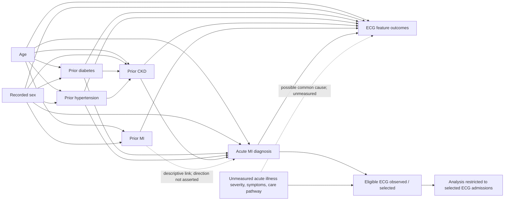

# Phase 4 - Final Proposed Causal Graph

## Status and scope

This is the finalized **proposed** graph for the roadmap's two questions. It is an explicit assumption set, not a graph learned from the data or clinically validated. Current analyses observe coded diagnoses and ECG records only among selected admissions. They do not establish biological MI onset or the order of MI and the selected ECG.

`ECG feature outcomes` means the 95 existing handcrafted features, grouped as ST, Q, R, T, QRS, RR, and other morphology. `QRS_Dur_Global_count` remains a separate technical/support measure. The 64 beta-VAE dimensions are excluded. No ECG feature is represented as an MI predictor.

The arrow `MI diagnosis -> ECG features` preserves the roadmap's proposed causal direction. It is not established for this dataset: ECG time is an in-encounter timestamp, not a validated MI onset time. The association analysis is therefore described as adjusted association, and the arrow remains an assumption requiring clinical review.

## Layer 1 adjustment sets

| Exposure | Outcome | Adjustment set | Interpretation |
|---|---|---|---|
| Prior diabetes | Acute MI diagnosis at admission | Age, recorded sex | Proposed risk-factor contrast |
| Prior hypertension | Acute MI diagnosis at admission | Age, recorded sex | Proposed risk-factor contrast |
| Prior CKD | Acute MI diagnosis at admission | Age, recorded sex, prior diabetes, prior hypertension | Does not adjust for prior MI |
| Prior MI | Acute MI diagnosis at admission | Age, recorded sex, prior diabetes, prior hypertension, prior CKD | Descriptive only; no causal discovery claim |

Diabetes and hypertension are not adjusted for CKD in their models. CKD and diabetes/hypertension ordering is assumed for the proposed graph, not established by these data. Because diabetes-versus-hypertension ordering is unclear, the alternative `diabetes -> hypertension` and `hypertension -> diabetes` orderings remain sensitivity graphs and are mutually exclusive: test one at a time. The displayed graph leaves both direct arrows to CKD; prior MI is not used to discover the chronic-condition ordering.

## Layer 2 adjustment set

For each of the 94 physiological features and the technical support feature, the proposed adjustment set is age (modeled flexibly), recorded sex, prior diabetes, prior hypertension, prior CKD, and prior MI. These are prior-history/coded variables as defined in Phase 3. Do not include same-admission treatments, troponin, ECG labels, or beta-VAE values. The technical count feature is reported as measurement support, not as a physiological response.

The graph includes ECG selection as a mechanism. MI diagnosis and unmeasured illness severity can both affect ECG availability. Conditioning on an observed ECG can open a noncausal path between MI and severity; severity may also affect ECG measurements. The existing Phase 3 selection report shows substantial measured differences between selected and nonselected admissions. Its audit is reused without rebuilding the selection cohort.

## Conditional independence implications

The pared-down measured-parent Layer 2 graph (MI and measured baseline covariates as the only parents of each feature, and no shared ECG substrate or selection pathway) implies that distinct feature outcomes are conditionally independent given MI, age, sex, diabetes, hypertension, CKD, and prior MI. This is a deliberately strong implication of that simplified graph. The full selection-aware graph above does **not** guarantee that independence: shared waveform physiology, unmeasured severity, and conditioning on ECG availability can leave residual dependence. The pairwise checks in `PHASE4_CONDITIONAL_INDEPENDENCE_TESTS.csv` diagnose the simplified implication and its departures; they do not test or validate the latent-variable pathways.

No conditional independence between a Layer 1 exposure and acute MI is implied: each exposure is a proposed cause of the outcome. Nor is independence of acute MI and ECG features implied; the proposed graph includes an MI-to-ECG path. The chronic-factor ordering and prior-MI relation are not discovered through independence testing in this dataset.

## Timing and target population limits

The dataset's selected ECG is the earliest eligible ECG in an admission. It does not establish whether MI onset preceded the ECG. Do not label these records pre-MI or post-MI, infer event time, or interpret the proposed arrow as a verified temporal effect. The empirical ECG population is adult admissions with an eligible ECG, not all admissions or the community. All Phase 4 diagnostics use training patients only.
