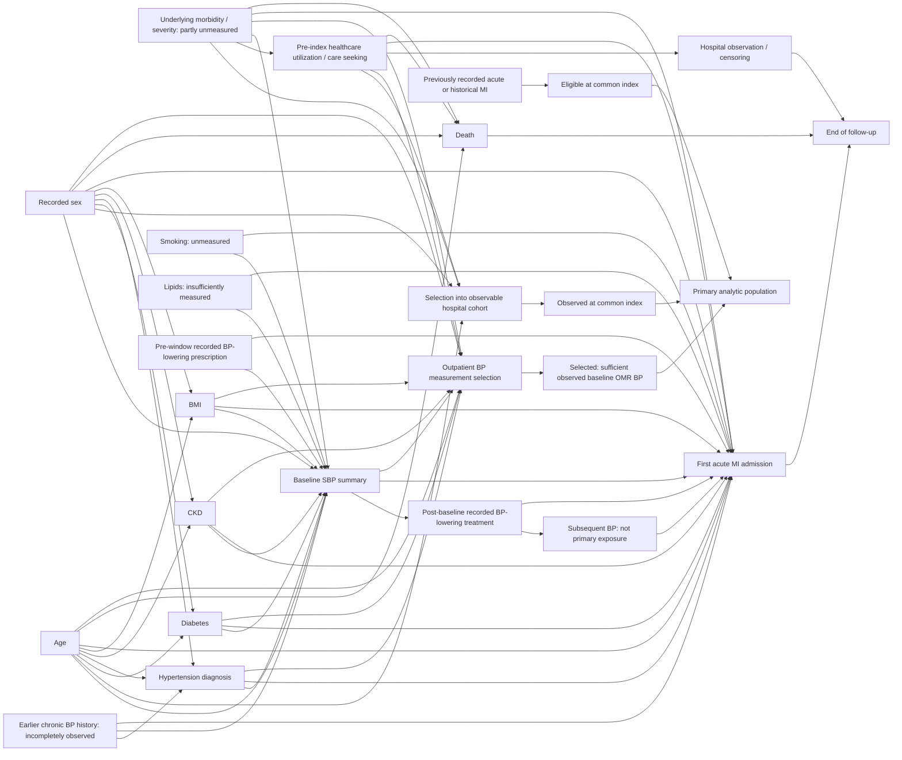

# Revised Phase 1 — Causal DAG and Identification

Status labels: **Finalised design choice**, **Recommended candidate**, **Unresolved decision**, **Assumption requiring empirical assessment**. This is a scientifically motivated working graph, not a clinically validated or data-learned DAG. Estimand and intervention are defined in `EXTENSION_PHASE1_ESTIMANDS.md`.

## Primary working DAG

The graph compresses time. `A` is the baseline 730-day-window SBP summary, while `A2` represents later BP potentially affected by post-baseline treatment. `PriorBP` represents incompletely observed BP history before the exposure window; it can contribute to a hypertension diagnosis, baseline SBP, and MI risk. `V` represents underlying morbidity/severity that may affect hospital entry, utilization, measurement selection, BP, MI, and death. The primary hypothetical intervention changes `A`; it is not a claim that a treatment was assigned or sustained. Hypertension is measured before the exposure window under the recommended covariate rule and acts as a proxy for chronic history. Alternative graphs may treat it as a weaker proxy or a healthcare-contact marker. Pre-window medication records are potential confounder proxies; post-baseline treatment is a potential mediator. The graph is acyclic; arrows are not asserted between a diagnosis and readings that temporally precede it.

## Node roles

| Node | Role in design | Primary handling |
|---|---|---|
| Baseline SBP `A` | Continuous exposure | Mean valid outpatient SBP in fixed pre-index window, subject to measurement sufficiency decision |
| Age, recorded sex | Candidate confounders and effect modifiers | Adjust; prespecified heterogeneity candidates |
| Diabetes | Candidate confounder and effect modifier | Diagnosis before exposure-window start under proposed timing rule; adjust and assess heterogeneity |
| Hypertension | Candidate confounder/proxy for earlier chronic BP history; can also mark healthcare contact | Candidate adjuster only when documented before exposure window; proxy is imperfect |
| CKD | Candidate confounder | Include if documented before exposure-window start under recommended temporal rule; assess detection |
| BMI | Candidate confounder | Include only with a valid pre-window OMR measure under prespecified rule; missingness/selection sensitivity |
| Prior MI history/documentation | Candidate in initial variable list, but excluded by eligibility when documented by index | Structurally unavailable as variable in primary eligible cohort; no primary adjustment. Resolve conflict before analysis |
| Pre-window medication status | Candidate confounder/proxy; prescription/administration is not actual use | Do not automatically adjust; use only carefully defined recorded-prescription sensitivity |
| Post-baseline medication/treatment | Potential mediator of later BP and MI risk | Do not adjust as a baseline confounder |
| Smoking, lipids, earlier chronic BP, underlying severity | Unmeasured or insufficiently measured confounders | Show as latent/partly observed nodes; never impute fictional observed history |
| Healthcare utilization | Confounder of measurement/diagnosis and cause of cohort selection; partially observed | Use available pre-index proxies in selection/missingness models and sensitivity analysis |
| Hospital cohort entry / index observation | Selection variables | Defines target population; limits transportability |
| OMR BP selection | Selection into exposure-observed analysis | Compare selected/nonselected; optional selection weighting with explicit assumptions |
| First acute MI | Outcome | First coded admission after index |
| Death | Competing event | Competing-risk cumulative incidence if dates/linkage defensible; underascertainment sensitivity |
| Censoring / observation end | Follow-up process | Model or sensitivity-adjust only under specified assumptions; intermittent records are not continuous surveillance |

Selection nodes are shown for clarity. Conditioning on hospital entry and BP observation can create collider paths (for example, illness severity/utilization affecting both BP measurement and MI). The DAG does not imply that adjustment for every node is safe.

## Candidate adjustment set

**Recommended primary candidate:** age, recorded sex, documented diabetes, documented hypertension, and documented CKD, with diagnoses defined strictly before the start of the 730-day exposure window (`index_date - 730 days`). Use age at window start and recorded sex. A diagnosis during the exposure window can follow some BP readings and is not automatically a baseline confounder. Add BMI only if measured before that window and its source, date, units, and completeness meet a predeclared rule; otherwise present an expanded complete-case/appropriately handled BMI sensitivity analysis. The operational look-back and missing categories require confirmation. This temporal rule is a recommended candidate requiring team approval.

Do not include prior MI in the primary adjustment set under the current eligibility rule: documented acute or historical MI by index causes exclusion, making the covariate constant among eligible records. Do not include post-index diagnoses, BP, medication, or treatment as baseline confounders. Medication sensitivity may be reported only as a separately interpreted adjustment set, because baseline outpatient exposure/adherence is not established and medication may lie on pathways from prior BP to later risk.

## Important arrow assumptions and alternatives

1. **Hypertension diagnosis:** In the primary working graph, earlier chronic BP contributes to diagnosis and baseline BP; a pre-window diagnosis may affect later BP and MI risk. Alternative graph A treats diagnosis only as a proxy for chronic BP (not a separate cause); alternative B treats coding mainly as a marker of healthcare contact and detection. Compare adjustment choices and explain interpretation; diagnosis timing alone cannot recover lifetime BP.
2. **BMI:** BMI may influence BP and MI; its role is plausible but measurement may be selective. Include only if pre-window temporal validity is established.
3. **Medication:** A pre-window prescription may proxy treatment affecting baseline BP and MI; post-baseline treatment may mediate pathways from baseline BP to later BP/MI. A prescription is not proof of outpatient use, adherence, dose, or index exposure. Do not adjust indiscriminately.
4. **Unmeasured smoking/lipids:** Both can affect BP and MI. No observed substitutes are invented. Residual confounding remains plausible.
5. **Selection:** Utilization and morbidity affect hospital entry, OMR measurement, diagnoses, and MI detection. Selection weighting can address only measured predictors under positivity and correct model assumptions.
6. **Death/censoring:** Death competes with MI; end of recorded admissions may reflect care elsewhere or no further admission. Death and censoring processes are not assumed independent without assessment.

## Identification assumptions

- **Consistency:** the intervention has a well-defined meaning for the measured baseline summary. A 10-mmHg measurement shift is not itself a treatment regimen; multiple real interventions could produce the same value with different effects.
- **Conditional exchangeability:** measured baseline covariates suffice to block confounding of SBP and first MI. This is doubtful if smoking/lipids, severity, care access, or medication use are not captured.
- **Positivity:** each relevant covariate profile must support observed SBP values at both reference and shifted values. Conditional densities, support, shifted-value support, and unsupported fraction are required; marginal bins/min-max checks do not establish this.
- **Temporal order:** OMR date strictly precedes index; time-varying adjustment variables must precede the baseline exposure window under the recommended rule; outcome follows index. Date-only data do not resolve within-day sequence, so index-date BP is excluded. A “by index” diagnosis can still postdate readings in the window.
- **Measurement validity:** parsing and QC reflect clinically meaningful SBP/DBP; repeated-measurement summary is reliable and not dominated by measurement intensity.
- **Outcome validity:** ICD codes identify first acute MI admissions with adequate sensitivity/specificity, while prior undocumented MI remains possible.
- **Selection:** conditional on measured predictors, BP observation and inclusion do not induce residual bias; untestable in full.
- **Competing event/censoring:** death linkage is adequate for chosen cumulative incidence or censoring model; otherwise sensitivity bounds/analyses are needed.
- **Model correctness:** nuisance models, functional forms, interactions, and uncertainty procedure are adequate; later diagnostics/cross-fitting reduce but do not eliminate misspecification.

No assumption above is established by Phase 0. The Phase 1 decision register and limitations file identify required review and evidence.
